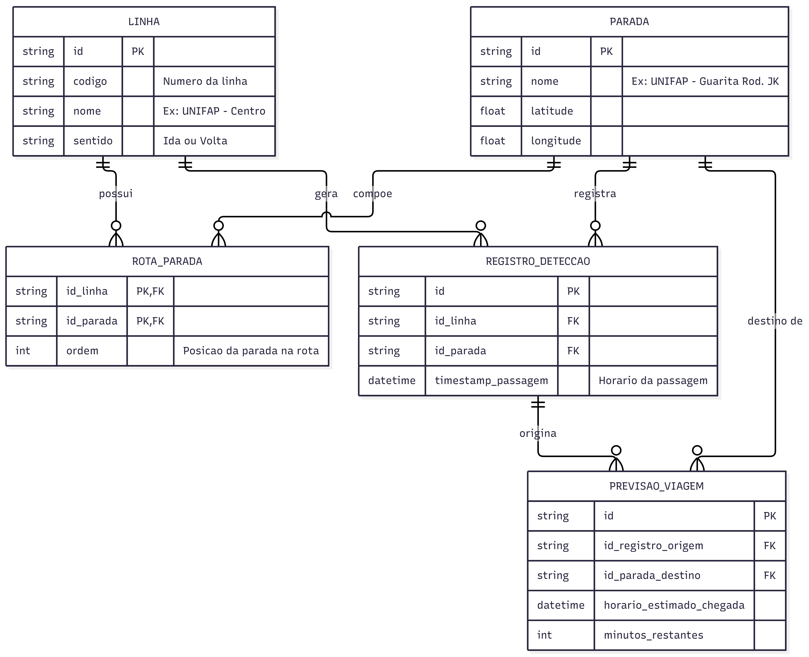

# Pythonisa — Parecer de Decisões e Planejamento do MVP

## 1. Decisões


| Aprovação | Decisão                                                                                                                                                                  | Motivo                                                                                                                   |
| ----------- | ------------------------------------------------------------------------------------------------------------------------------------------------------------------------- | ------------------------------------------------------------------------------------------------------------------------ |
| OK          | **Modelo de banco simplificado**                                                                                                                                          | O passageiro só precisa de linha, parada e horário (entidade Veículo removida)                                        |
| OK          | **Dados simulados** de passagem dos ônibus                                                                                                                               | Contorna a falta de infraestrutura de captura                                                                            |
| Pendente    | **Servidor intermediário em Python (FastAPI)** entre o app e os dados                                                                                                    | Separa o app da fonte de dados; facilita trocar o mock por dados reais                                                   |
| Pendente    | **Localização por GPS simulado**, com opção de trocar a parada manualmente<br />com exibição do mapa, OU seletor expansível (dropdown) com as paradas disponíveis | Experiência realista na apresentação, sem depender de sinal de GPS; segunda opção mantém a simplicidade para o MVP |
| Pendente    | **Escopo reduzido a** 2 linhas urbanas que passam pela UNIFAP                                                                                                             | Protótipo viável e fácil de demonstrar (foco no trajeto universitário)                                               |
| Pendente    | **Previsão a partir do tempo de trajeto entre paradas** conforme script de Gabriel                                                                                     | Mais estável do que prever o horário absoluto de chegada                                                               |

## 2. Proposta de Fluxo

```
[ App Flutter ]  →  [ Servidor FastAPI ]  →  [ Banco SQLite + Modelo de Predição ]
                                                      ↑
                                             [ Simulador de passagens ]
```

1. O app envia a localização do usuário (ou a parada selecionada na lista).
2. O servidor identifica a **parada mais próxima** (ou valida a parada escolhida).
3. O app mostra as **linhas** que atendem essa parada.
4. O usuário escolhe uma linha, e o servidor calcula a **previsão de chegada**.

## 3. Parâmetros Trocados entre App e Servidor


| O app envia                                                                                                           | O servidor responde                                                                 |
| --------------------------------------------------------------------------------------------------------------------- | ----------------------------------------------------------------------------------- |
| Localização do usuário (latitude/longitude) OU o usuário apenas seleciona a parada dele no mapa ou em um dropdown | Parada mais próxima e a distância até ela                                        |
| Parada selecionada                                                                                                    | Linhas que atendem a parada                                                         |
| Linha + parada                                                                                                        | Previsão de chegada, minutos restantes e onde o ônibus foi visto pela última vez |

## 4. Modelo Entidade-Relacionamento




| Entidade                | Papel                                                                                                                                     |
| ----------------------- | ----------------------------------------------------------------------------------------------------------------------------------------- |
| **Linha**               | Identificação da linha de ônibus (código, nome, sentido).                                                                             |
| **Parada**              | Ponto de ônibus com coordenadas de latitude e longitude.                                                                                 |
| **Rota_Parada**         | Relação que define quais paradas compõem a linha e a sequência exata (`ordem`) em que o ônibus passa por elas.                       |
| **Registro_Detecção** | Registro histórico/simulado do momento exato em que um ônibus da linha passou por uma determinada parada.                               |
| **Previsão_Viagem**    | Registro simplificado do cálculo preditivo gerado (horário previsto e minutos restantes) para fins de histórico e auditoria do modelo. |

> **Nota sobre Simplificações Adotadas:**
>
> * **Remoção de `Veículo`:** Como o foco do MVP é a detecção da linha via letreiro ou simulação por rota, não é necessário mapear placas ou frotas de carros específicos. A linha basta.
> * **Utilidade de `Rota_Parada`:** Uma linha passa por várias paradas e uma parada atende várias linhas (relação N:N). Essa entidade é obrigatória para que o sistema saiba a sequência do trajeto e se o ônibus detectado na "Parada A" ainda vai chegar na "Parada B" (onde o aluno está) ou se já passou dela.

## 5. Próximos Passos

1. Definir as **2 linhas reais** e as **paradas** (com coordenadas) do MVP.
2. Criar o banco a partir do modelo acima e gerar os dados simulados.
3. Adaptar o notebook de predição para um serviço no servidor.
4. Implementar os endpoints no servidor FastAPI.
5. Integrar o app Flutter ao servidor.

## 6. Pontos em Aberto pendentes de Aprovação

- **Escopo reduzido a 2 linhas urbanas que passam pela UNIFAP?** (Definir quais linhas e paradas reais serão usadas).
- **Servidor intermediário em Python (FastAPI)** entre o app e os dados?
- **Localização por GPS simulado com mapa OU seletor suspenso (dropdown)** com as paradas disponíveis no campus da UNIFAP?
- **Previsão a partir do tempo de trajeto entre paradas ($\Delta t$)** adaptando o script de Gabriel? (Explicação no item 7).
- Quando e como os dados reais substituirão os simulados.

## 7. Modelo de predição da chegada do ônibus (Script Gabriel)

Utilização de **Regressão Linear** (via `scikit-learn`) para prever o tempo de chegada dos ônibus.

1. **Simulação de Dados:**
   * O código gera um histórico fictício de viagens para três linhas de ônibus (`L1`, `L2`, `L3`) transitando de uma `Parada_A` para uma `Parada_B`.
   * Cada registro contém a hora de partida, a linha correspondente e o tempo de viagem simulado (de 5 a 20 minutos).
2. **Engenharia de Features (Atributos):**
   * **Variável Alvo ($y$):** A hora de chegada real convertida em segundos desde o início do dia (`hora_chegada_segundos`). *(Proposta de adaptação para o MVP: prever o tempo de viagem $\Delta t$ em minutos).*
   * **Variáveis Preditoras ($X$):**
     * A hora de partida convertida em segundos (`hora_partida_segundos`).
     * O dia da semana da partida (`dia_semana_partida`).
     * Variáveis categóricas binárias (*One-Hot Encoding*) para identificar a linha do ônibus (`linha_L1`, `linha_L2`, `linha_L3`).
   * *Nota de Melhoria:* Na célula mais recente, foi removido o vazamento de dados (*data leakage*) que ocorria ao utilizar a duração exata da viagem como preditor direto.
3. **O Modelo (Regressão Linear):**
   * A Regressão Linear estabelece uma correlação matemática linear entre o horário de partida, a linha e o horário de chegada.
   * O desempenho atual apresenta um **R² de 1.00** e um **Erro Médio Absoluto (MAE) de ~18 a 19 minutos**. Esse comportamento decorre da modelagem em segundos acumulados ao longo do dia; a migração para previsão de $\Delta t$ (tempo de trajeto em minutos entre as paradas) proporcionará estimativas pontuais muito mais precisas e intuitivas para o passageiro.
