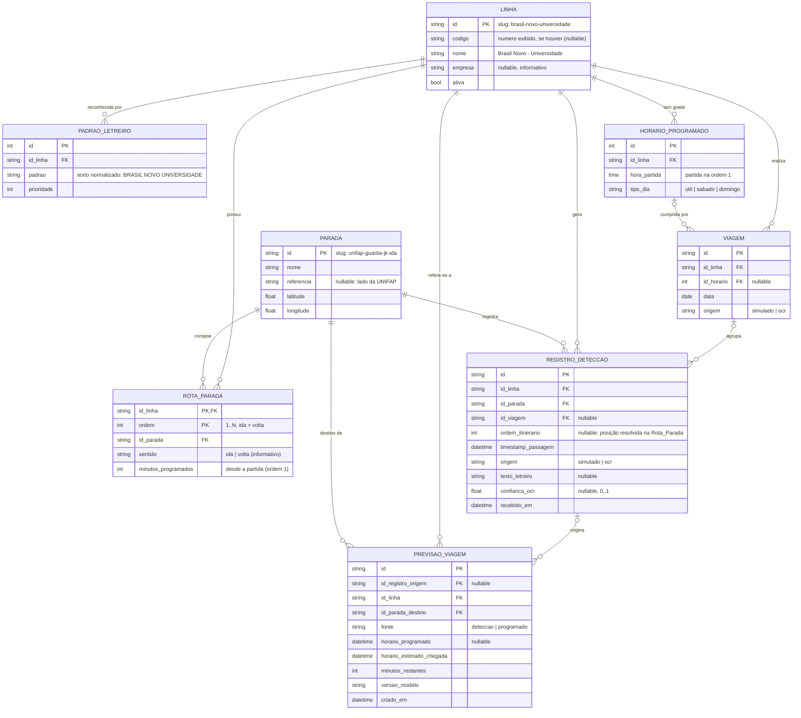

# Pythonisa — Servidor Intermediário (FastAPI) — Design do MVP

- **Data:** 2026-11-08
- **Status:** rascunho para validação do grupo
- **Escopo:** este repositório (`pythonisaFastApi`). App Flutter e Visão Computacional são repositórios separados.
- **Base:** `docs/Overview Outubro Pythonisa.md`, `predicaoChegada.ipynb`, considerações da frente de Visão Computacional e leitura do app `Unifap-pythonisa/pythonisa_app` (branch `main`).

---

## 1. Intenção

O passageiro escolhe **a parada onde está** e quer saber **quando o próximo ônibus de uma linha chega ali**, no estilo Google Maps: o horário programado e o horário previsto, com a indicação de adiantado ou atrasado.

O servidor é a única fonte de dados do app. Ele guarda linhas, paradas, itinerários, grade de horários e registros de passagem em SQLite e calcula a previsão com um modelo de Regressão Linear que estima o tempo de deslocamento (Δt) entre paradas consecutivas.

No MVP, as passagens dos ônibus são **simuladas**. O simulador grava os dados pela mesma porta de entrada que a Visão Computacional vai usar depois. Assim, trocar dado simulado por dado real não exige mudar o modelo de dados, a API do app nem o serviço de previsão.

### Como fica a demonstração

1. O app lista as paradas da UNIFAP, e o usuário escolhe a dele (ou o app sugere a mais próxima por coordenada).
2. O app mostra as linhas que atendem aquela parada, cada uma com sua próxima chegada.
3. Para a linha escolhida aparecem os dados da chegada. Exemplo: programado 09:30, previsto 09:27, adiantado 3 min, faltam 6 min, visto pela última vez em "Terminal Macapaba" há 12 min.
4. Fora do horário de pico o ônibus tende a adiantar e no pico tende a atrasar. Esse comportamento vem da regressão treinada sobre o histórico simulado.

---

## 2. Objetivos, não-objetivos e anti-objetivos

**Objetivos**
- API REST que cobre o fluxo parada → linhas → previsão do app.
- MER revisado à luz das restrições do OCR por letreiro, implementado em SQLite.
- Dados das linhas **Macapaba – Amapá Garden** e **Brasil Novo – Universidade**, com paradas, itinerário e grade. São simulados, estimados a partir de mapas públicos e editáveis sem mexer em código.
- Simulador de histórico, que alimenta o treino, e de passagens "ao vivo", que alimentam a previsão na hora da demo.
- Modelo de Δt por trecho encapsulado atrás de uma interface, com métricas expostas para a banca.
- Contrato de ingestão de detecções pronto para a Visão Computacional.

**Não-objetivos (fora do MVP)**
- Autenticação, deploy em nuvem, PostgreSQL, migrações com Alembic.
- Integração real com o pipeline de OCR. Entra só o contrato e a validação.
- GPS real do ônibus, entidade `Veículo`, entidade `Empresa`.
- Modelos não lineares (árvores, LSTM). A interface permite trocar depois.
- Alterações no app Flutter. Este repositório entrega o contrato, e o app se adapta.

**Anti-objetivos (o que seria falha mesmo funcionando)**
- O texto `UNIVERSIDADE` sozinho no letreiro ser aceito como alguma linha.
- Uma previsão "perfeita" que só reproduz o mock (R² = 1 sem significado). O simulador precisa ter ruído e o modelo precisa ser comparado com um baseline.
- Trocar mock por dado real exigir mudança no contrato do app.
- A demo depender do relógio de parede, por exemplo apresentar às 14h e não conseguir mostrar o efeito do pico.

---

## 3. Revisão do MER

### 3.1 O que muda e por quê

| Item | Decisão | Justificativa |
|---|---|---|
| `Linha.sentido` | **Removido de `Linha`**, passa a ser informativo em `Rota_Parada` | Cada lado da rua é uma `Parada` distinta. A ida e a volta são o mesmo itinerário com paradas diferentes, e o sentido vira uma propriedade do item do itinerário. |
| `Linha.empresa` | **Novo atributo opcional** (texto) | Pedido do grupo. Serve como informação extra de identificação, por exemplo se a VC um dia distinguir pela empresa ou pelo modelo do ônibus. Não vira entidade. |
| `Linha.id` | Texto legível (slug), ex.: `brasil-novo-universidade` | Facilita seed, logs e o contrato com app e VC. |
| `Padrao_Letreiro` | **Nova entidade** | O OCR lê só o ROI do letreiro, e o servidor precisa traduzir texto em `Linha`. Os padrões ficam em tabela, não em código, porque o mesmo ônibus exibe variações. |
| `Rota_Parada` PK | De `(id_linha, id_parada)` para **`(id_linha, ordem)`** | O itinerário completo (ida + volta) pode começar e terminar na mesma parada, o terminal. A ordem identifica a posição. |
| `Rota_Parada.minutos_programados` | **Novo** | Tempo programado desde a partida (ordem 1) até aquela parada. Dá o "programado 09:30" de cada parada a partir da grade. |
| `Horario_Programado` | **Nova entidade** | A grade de partidas na primeira parada. É a parte "tabelada" do estilo Google Maps. |
| `Viagem` | **Nova entidade** | Substitui `Veículo` de forma anônima: agrupa as passagens de **uma ida do ônibus** pelo itinerário, sem placa nem frota. Sem isso não dá para calcular o Δt entre paradas, porque é preciso saber que a passagem na parada 3 e na parada 4 são do mesmo ônibus. |
| `Registro_Deteccao` | **Novos campos:** `id_viagem` (opcional), `ordem_itinerario` (opcional, posição resolvida no itinerário; necessária para associar viagens e calcular Δt quando uma parada aparece mais de uma vez), `origem`, `texto_letreiro`, `confianca_ocr`, `recebido_em` | Distingue simulado de OCR, guarda o texto bruto para auditoria e permite filtrar o treino por origem e por confiança. |
| `Previsao_Viagem` | **Novos campos:** `fonte`, `horario_programado`, `versao_modelo`, `criado_em`; `id_registro_origem` passa a ser opcional | A previsão pode vir de uma detecção ou só da grade, quando não há ônibus detectado ainda. Também serve de auditoria do modelo. |
| `Parada.referencia` | **Novo, opcional** | Texto curto como "lado da UNIFAP" ou "em frente à guarita", para diferenciar as paradas dos dois lados da rua na lista do app. |

`Linha`, `Parada`, `Rota_Parada`, `Registro_Deteccao` e `Previsao_Viagem` continuam com o mesmo papel do overview.

### 3.2 Diagrama



### 3.3 Regras de identificação por letreiro

- **Normalização:** caixa alta, remoção de acentos e pontuação, espaços colapsados. Exemplo: `Brasil Novo / Universidade` vira `BRASIL NOVO UNIVERSIDADE`.
- **Casamento:** um padrão casa quando **todos os seus termos** aparecem no texto normalizado.
- **Desempate:** se mais de uma linha casar, vence a de maior `prioridade`. Se houver empate entre linhas diferentes, a detecção é **rejeitada como ambígua**.
- **Padrões:** cada linha recebe padrões que **sempre** incluem o termo distintivo (`BRASIL NOVO`, `MACAPABA`). Ex.: `MACAPABA GARDEN`, `MACAPABA AMAPA GARDEN`, `BRASIL NOVO UNIVERSIDADE`. Nenhum padrão é só `UNIVERSIDADE`, e há teste automatizado garantindo que esse texto é rejeitado.
- **Confiança:** detecções com `confianca_ocr` abaixo de um limiar configurável (padrão 0,6) são rejeitadas.

### 3.4 Associação de detecções a viagens

- **Detecção na ordem 1 (primeira parada):** cria uma nova `Viagem` e a liga ao `Horario_Programado` mais próximo, dentro de ±15 min. Fora dessa janela, a viagem fica sem horário e a situação é "sem grade".
- **Detecção numa ordem k > 1:** vai para a viagem mais recente da mesma linha, no mesmo dia, cuja última detecção esteja numa ordem menor que k e dentro de uma janela de tempo (padrão 120 min). Se nenhuma servir, o registro fica com `id_viagem = null`. Ele é guardado, mas não entra no treino nem na previsão.
- **Simulador:** passa pela mesma regra, sem atalho. Isso garante que o caminho que a VC vai usar já está exercitado.

---

## 4. Arquitetura do servidor

### 4.1 Stack (decisões minhas, podem ser revistas)

- **Python 3.13** (já instalado), ambiente com `venv` + `pip` e `pyproject.toml`. O `uv` não está instalado; dá para adotar depois sem impacto.
- **FastAPI** + **Uvicorn**; **Pydantic v2** + **pydantic-settings** para configuração via `.env`.
- **SQLAlchemy 2.x** síncrono + **SQLite** em arquivo (`data/pythonisa.db`). Tabelas criadas com `create_all`, sem Alembic no MVP.
- **scikit-learn**, **pandas** e **joblib** para o modelo.
- **pytest** + **httpx** (TestClient) para testes; **ruff** para lint e formatação.
- **Fuso horário:** `America/Belem` (UTC−3, sem horário de verão). A API recebe e devolve ISO 8601 com offset, e as features do modelo usam a hora local.

### 4.2 Estrutura de pastas

```
pythonisaFastApi/
├── pyproject.toml
├── README.md
├── .env.example
├── predicaoChegada.ipynb              # notebook original (referência, não importado)
├── docs/
├── data/                              # gitignored: pythonisa.db, modelos/*.joblib
├── src/pythonisa_api/
│   ├── main.py                        # create_app(), lifespan (carrega modelo, liga simulador)
│   ├── config.py                      # Settings (pydantic-settings)
│   ├── relogio.py                     # Relogio: agora() real ou fixado (demo/testes)
│   ├── api/
│   │   ├── deps.py                    # sessão de BD, relógio, preditor
│   │   ├── erros.py                   # formato padrão de erro
│   │   └── v1/
│   │       ├── linhas.py
│   │       ├── paradas.py
│   │       ├── previsoes.py
│   │       ├── deteccoes.py           # ingestão (VC e simulador)
│   │       └── modelo.py              # métricas/versão; retreino
│   ├── schemas/                       # Pydantic: entrada/saída da API
│   ├── db/
│   │   ├── base.py                    # engine, SessionLocal
│   │   └── models.py                  # ORM das 8 entidades
│   ├── services/                      # regras de negócio, sem FastAPI
│   │   ├── geo.py                     # haversine, parada mais próxima
│   │   ├── letreiro.py                # normalização + casamento de padrões
│   │   ├── deteccao.py                # validação, resolução de linha, associação a viagem
│   │   ├── itinerario.py              # ordem, trechos, horário programado na parada
│   │   └── previsao.py                # orquestra detecção/grade + preditor
│   ├── ml/
│   │   ├── preditor.py                # Protocol PreditorTrecho + implementações
│   │   ├── features.py                # registros → trechos (Δt) → features
│   │   └── treino.py                  # treino, avaliação, persistência do artefato
│   ├── simulador/
│   │   ├── trafego.py                 # fatores de horário/dia + ruído
│   │   ├── historico.py               # gera N dias de passagens em todas as paradas
│   │   └── ao_vivo.py                 # gera passagens na 1ª parada conforme o relógio
│   ├── seed/
│   │   ├── dados/                     # linhas.json, paradas.json, itinerarios.json, grade.json, letreiros.json
│   │   └── carregar.py
│   └── cli.py                         # python -m pythonisa_api.cli <comando>
└── tests/
    ├── unit/                          # letreiro, geo, itinerario, features, preditor, trafego
    └── integration/                   # API com SQLite temporário
```

As camadas se separam assim:

- `api/` só traduz HTTP para chamadas de `services/` e respostas em `schemas/`.
- `services/` não conhece FastAPI.
- `ml/` não conhece o banco: recebe DataFrames ou objetos.
- `simulador/` usa `services/deteccao.py`, a mesma entrada da VC.

### 4.3 Comandos de CLI

| Comando | O que faz |
|---|---|
| `init-db` | Cria as tabelas. |
| `seed` | Carrega linhas, paradas, itinerários, grade e padrões de letreiro a partir de `seed/dados/`. É idempotente. |
| `simular-historico --dias 60` | Gera o histórico de passagens. Recebe semente fixa e é reprodutível. |
| `treinar` | Treina e avalia o modelo, depois salva o artefato e as métricas. |
| `resetar` | Executa `init-db` + `seed` + `simular-historico` + `treinar` em sequência, para preparar a demo do zero. |

### 4.4 Configuração (`.env`)

| Variável | Padrão | Função |
|---|---|---|
| `DATABASE_URL` | `sqlite:///data/pythonisa.db` | Caminho do banco. |
| `SIMULADOR_AO_VIVO` | `true` | Liga o simulador ao vivo. |
| `SIMULADOR_INTERVALO_S` | `30` | Intervalo entre passadas do simulador. |
| `CONFIANCA_OCR_MINIMA` | `0.6` | Limiar de confiança do OCR. |
| `JANELA_ASSOCIACAO_MIN` | `120` | Janela para associar uma detecção a uma viagem. |
| `PERMITIR_RELOGIO_FIXO` | `true` em dev | Libera o parâmetro `agora` nos endpoints de previsão. |
| `CORS_ORIGINS` | `*` em dev | Origens liberadas. |

---

## 5. Endpoints (prefixo `/api/v1`)

A documentação interativa fica em `/docs` (OpenAPI gerado pelo FastAPI). Os exemplos abaixo são o contrato de referência para o app.

**Formato de erro padrão:**

```json
{ "erro": { "codigo": "PARADA_FORA_DA_LINHA", "mensagem": "A linha brasil-novo-universidade não atende a parada x." } }
```

**Códigos de erro:**

| Código | HTTP | Quando |
|---|---|---|
| `LINHA_NAO_ENCONTRADA` | 404 | Linha inexistente. |
| `PARADA_NAO_ENCONTRADA` | 404 | Parada inexistente. |
| `PARADA_FORA_DA_LINHA` | 422 | A linha não passa pela parada pedida. |
| `LETREIRO_DESCONHECIDO` | 422 | O texto do letreiro não casa com nenhuma linha. |
| `LETREIRO_AMBIGUO` | 422 | O texto casa com mais de uma linha (ver 3.3). |
| `CONFIANCA_BAIXA` | 422 | `confianca_ocr` abaixo do limiar. |
| `DADOS_INVALIDOS` | 422 | Payload inválido. |

### 5.1 Para o app

**`GET /health`**: retorna `{ "status": "ok", "modelo_carregado": true }`.

**`GET /linhas`**

```json
[
  { "id": "brasil-novo-universidade", "codigo": null, "nome": "Brasil Novo - Universidade", "empresa": "Capital Morena" },
  { "id": "macapaba-amapa-garden", "codigo": null, "nome": "Macapaba - Amapá Garden", "empresa": "Capital Morena" }
]
```

**`GET /linhas/{id_linha}/paradas`**: o itinerário ordenado, para desenhar a rota no mapa.

```json
{
  "linha": { "id": "macapaba-amapa-garden", "nome": "Macapaba - Amapá Garden" },
  "itinerario": [
    { "ordem": 1, "sentido": "ida", "minutos_programados": 0,
      "parada": { "id": "terminal-macapaba", "nome": "Terminal Macapaba", "referencia": null, "latitude": 0.0, "longitude": 0.0 } }
  ]
}
```

**`GET /paradas`** (filtro opcional `?id_linha=`)

```json
[ { "id": "unifap-guarita-jk-ida", "nome": "UNIFAP - Guarita Rod. JK", "referencia": "lado da UNIFAP", "latitude": 0.0, "longitude": 0.0 } ]
```

**`GET /paradas/proxima?latitude=..&longitude=..`**

```json
{ "parada": { "id": "...", "nome": "...", "referencia": "...", "latitude": 0.0, "longitude": 0.0 }, "distancia_metros": 84 }
```

**`GET /paradas/{id_parada}/linhas`**: as linhas que atendem a parada, no mesmo formato de `GET /linhas`.

**`GET /previsoes?id_linha=..&id_parada=..`** (opcional `&agora=2026-11-10T07:40:00-03:00` quando `PERMITIR_RELOGIO_FIXO`): o endpoint principal.

```json
{
  "linha":  { "id": "macapaba-amapa-garden", "nome": "Macapaba - Amapá Garden" },
  "parada": { "id": "unifap-guarita-jk-ida", "nome": "UNIFAP - Guarita Rod. JK" },
  "situacao": "adiantado",
  "fonte": "deteccao",
  "horario_programado": "2026-11-08T09:30:00-03:00",
  "horario_previsto":   "2026-11-08T09:27:10-03:00",
  "minutos_restantes": 6,
  "diferenca_minutos": -3,
  "ultima_deteccao": {
    "parada": { "id": "terminal-macapaba", "nome": "Terminal Macapaba" },
    "timestamp": "2026-11-08T09:09:02-03:00",
    "paradas_ate_voce": 5
  },
  "versao_modelo": "regressao-linear-2026-11-08T10:02",
  "gerado_em": "2026-11-08T09:21:00-03:00"
}
```

Significado dos campos:

- **`situacao`** pode ser:
  - `adiantado` quando `diferenca_minutos` < −1;
  - `atrasado` quando `diferenca_minutos` > +1;
  - `no_horario` quando a diferença fica entre −1 e +1;
  - `sem_grade` quando não há horário programado associado;
  - `sem_servico` quando não há mais ônibus no dia. Nesse caso os demais campos de horário vêm `null`.
- **`fonte`:**
  - `deteccao` quando existe ônibus detectado antes da parada;
  - `programado` quando ainda não há detecção. A previsão então parte do próximo horário da grade e soma os Δt previstos, e `ultima_deteccao` vem `null`.
- **`diferenca_minutos`:** previsto menos programado. Negativo significa adiantado.

**`GET /paradas/{id_parada}/previsoes`**: o "painel da parada", com a próxima chegada de cada linha que atende a parada. É o mesmo objeto acima, em lista, ordenada por `minutos_restantes`. Atende o fluxo em que o usuário escolhe só a parada.

### 5.2 Ingestão (Visão Computacional e simulador)

**`POST /deteccoes`**

```json
{
  "id_parada": "terminal-macapaba",
  "timestamp_passagem": "2026-11-08T09:09:02-03:00",
  "texto_letreiro": "MACAPABA AMAPA GARDEN",
  "id_linha": null,
  "confianca_ocr": 0.91,
  "origem": "ocr"
}
```

Regras de validação:

- É obrigatório informar `texto_letreiro` **ou** `id_linha`. Se vierem os dois, o servidor confere se são consistentes.
- `id_parada` é a parada onde a câmera está instalada e precisa fazer parte do itinerário da linha resolvida.
- `origem` aceita `ocr` ou `simulado`.

**Resposta 201:**

```json
{ "id": "…", "id_linha": "macapaba-amapa-garden", "id_parada": "terminal-macapaba", "id_viagem": "…", "origem": "ocr", "recebido_em": "…" }
```

### 5.3 Modelo

**`GET /modelo`**: as métricas do modelo carregado, para mostrar à banca.

```json
{ "versao": "regressao-linear-2026-11-08T10:02", "treinado_em": "…", "amostras_treino": 18000, "amostras_teste": 3000,
  "mae_segundos": 41.2, "mae_baseline_segundos": 63.5, "r2": 0.62, "origens_usadas": ["simulado"] }
```

**`POST /modelo/treinar`**: retreina com os registros atuais e recarrega o modelo, sem reiniciar o servidor. Em produção ficaria protegido; no MVP fica aberto.

---

## 6. Dados simulados

### 6.1 Seed

Os dados ficam em JSON dentro de `src/pythonisa_api/seed/dados/`, versionados, para o grupo corrigir nomes e coordenadas sem tocar em código.

- **Paradas e itinerários:** **estimados a partir do OpenStreetMap e de mapas públicos**, com cerca de 8 a 12 paradas por sentido em cada linha, e marcados como simulados no README.
  - Paradas dos dois lados da rua são registros distintos, ex.: `unifap-guarita-jk-ida` e `unifap-guarita-jk-volta`.
  - As paradas da UNIFAP são **compartilhadas pelas duas linhas**, para o painel da parada mostrar duas opções.
  - O grupo valida a lista antes da demo.
- **`minutos_programados`:** derivados da distância entre paradas, com uma velocidade média programada de cerca de 20 km/h.
- **Grade:** em dia útil, partidas a cada 30 min das 05:30 às 22:00. Sábado a cada 45 min. Domingo a cada 60 min. Os valores são editáveis.
- **Padrões de letreiro:** conforme 3.3.

### 6.2 Modelo de tráfego do simulador (`simulador/trafego.py`)

Para cada trecho *i → i+1* de uma viagem:

```
Δt = Δt_base_trecho × fator_horario(hora) × fator_dia(tipo_dia) × ruído
```

- `Δt_base_trecho` é o tempo de percurso do trecho fora do pico. Fica **abaixo** do programado, para o ônibus tender a adiantar fora do pico.
- `fator_horario` vale cerca de 1,30 nos picos (06:30–08:30, 11:30–13:30, 17:00–19:00) e cerca de 0,85 fora deles. Há transições suaves entre faixas.
- `fator_dia` vale 1,0 em dia útil, 0,9 no sábado e 0,8 no domingo.
- `ruído` é log-normal com desvio de cerca de 10%. Em ~3% dos trechos entra um atraso extra (evento). Isso impede R² = 1.
- A partida na ordem 1 varia em torno da grade, com desvio de cerca de 2 min.

Todos os parâmetros ficam centralizados e têm semente fixa, de modo que o histórico é reprodutível.

### 6.3 Histórico e passagens ao vivo

- **Histórico (`simular-historico`):** os últimos N dias (padrão 60), com **passagens em todas as paradas** de cada viagem da grade. É a base de treino. *Minha decisão:* sem passagens em todas as paradas não há como aprender o Δt de cada trecho.
- **Ao vivo (`simulador/ao_vivo.py`):** uma tarefa assíncrona iniciada no `lifespan` roda a cada `SIMULADOR_INTERVALO_S`.
  - Gera **apenas a passagem na primeira parada** das viagens de hoje cujo horário simulado já chegou, sempre via `services/deteccao.py`.
  - Isso imita uma câmera no ponto inicial: o servidor sabe que o ônibus saiu e o modelo estima o resto.
- **Relógio fixo para a demo:** o parâmetro `agora` nos endpoints de previsão permite mostrar o efeito do pico em qualquer horário de apresentação.
  - O serviço de previsão usa um `Relogio` injetado.
  - Com `agora` informado, as passagens "ao vivo" consideradas são as geradas deterministicamente pelo simulador para aquele instante, calculadas sob demanda sem gravar no banco. Assim a demo não depende do que a tarefa em segundo plano já gravou.
  - **Determinismo:** as passagens ao vivo de uma viagem são função pura de (linha, data, horário da grade). A semente é derivada dessa tupla. Por isso a tarefa em segundo plano grava exatamente o que o cálculo sob demanda produziria.
  - **Fonte das passagens:** `services/previsao.py` recebe uma `FontePassagens` com duas implementações, banco ou simulada para um `agora`. A escolha é feita em `api/deps.py`: com `agora` informado usa a simulada, sem `agora` usa o banco.

---

## 7. Machine Learning

### 7.1 O que muda em relação ao notebook

O notebook prevê o **horário absoluto de chegada em segundos do dia**, para uma única parada A→B. Isso gera R² = 1,00 com MAE de ~18 min, porque o horário de partida já "explica" o de chegada. Além disso, como a relação com a hora é linear, o modelo não consegue representar picos.

O MVP passa a usar:

- **Alvo:** **Δt de um trecho** (segundos entre a passagem na ordem *i* e na *i+1* da mesma viagem), conforme proposto no overview.
- **Features:**
  - `trecho` (categórica: linha + ordem de origem);
  - `faixa_horaria` (categórica: hora cheia do momento de entrada no trecho);
  - `tipo_dia` (categórica).

  Tudo passa por One-Hot dentro de um `Pipeline` do scikit-learn (`OneHotEncoder` + `LinearRegression`). Como a hora entra como categoria, o modelo continua linear e interpretável, mas consegue representar o pico.
- **Sem vazamento:** nada que dependa do próprio Δt entra como feature.

### 7.2 Encapsulamento

```python
class PreditorTrecho(Protocol):
    versao: str
    def prever_segundos(self, id_linha: str, ordem_origem: int, momento: datetime) -> float: ...
```

- **`RegressaoLinearPreditor`** é o modelo principal, carregado de `data/modelos/*.joblib`.
- **`MediaHistoricaPreditor`** é o baseline (média por trecho e faixa horária). Serve para comparar métricas e é usado como fallback se não houver modelo treinado.
- **Troca futura:** basta outra implementação do Protocol (ex.: Random Forest) e um parâmetro de configuração. Nem a API nem o `services/previsao.py` mudam.

### 7.3 Treino e avaliação (`ml/treino.py`)

1. **Montagem dos trechos:** lê `Registro_Deteccao` com `id_viagem` não nulo e com `origem` dentro das origens configuradas (`simulado` no MVP, `ocr` no futuro).
   - Agrupa os registros por viagem e forma pares de ordens consecutivas, cada par virando um trecho com seu Δt.
   - Descarta Δt fora de limites plausíveis.
2. **Divisão temporal:** os últimos 7 dias ficam para teste, não há divisão aleatória. Isso evita treinar com o "futuro".
3. **Métricas:** MAE e R² do modelo e do baseline.
4. **Persistência:** salva o artefato e as métricas em JSON. O `lifespan` carrega o artefato na subida, e se ele não existir usa o baseline.

### 7.4 Cálculo da previsão (`services/previsao.py`)

Entrada: `id_linha`, `id_parada`, `agora`.

1. **Localizar a parada no itinerário.** Busca as ordens *k* em que a parada aparece. Se ela aparecer mais de uma vez, avalia cada ocorrência e fica com a chegada mais próxima.
2. **Previsão com detecção (`fonte = deteccao`):**
   - Procura entre as viagens de hoje da linha, dentro da janela de associação, a que tem a última detecção numa ordem *d* < *k*. Se houver mais de uma, escolhe a de maior *d*, ou seja, o ônibus mais próximo.
   - Parte de `t = timestamp(d)` e, para cada trecho de *d* até *k − 1*, soma `t += preditor.prever_segundos(linha, i, t)`. Considera só os resultados com `t ≥ agora`.
3. **Previsão pela grade (`fonte = programado`):** quando não há candidato, pega a próxima partida da grade a partir de `agora` e aplica a mesma soma a partir da ordem 1.
4. **Horário programado:** `hora_partida` do horário da viagem + `minutos_programados[k]`.
5. **Situação e diferença:** calculadas conforme 5.1.
6. **Registro:** grava `Previsao_Viagem` para auditoria (best effort: se falhar, não derruba a resposta).

---

## 8. Testes

- **Unitários:**
  - normalização e casamento de letreiro, incluindo `UNIVERSIDADE` sozinho → rejeitado e empate → ambíguo;
  - haversine e parada mais próxima;
  - horário programado na parada;
  - associação a viagem;
  - montagem de trechos (Δt);
  - fatores do simulador;
  - previsão com um preditor falso de Δt constante, para tornar o resultado exato e testável.
- **Integração:** cada endpoint do app e o de ingestão sobre um SQLite temporário com seed reduzido e relógio fixo.
- **Smoke de ML:** treino sobre um histórico pequeno, verificando que o MAE do modelo fica ≤ MAE do baseline e que o artefato carrega.

---

## 9. Checklist de execução do MVP

Ordem sugerida. Cada etapa termina com testes passando. O plano detalhado, com passos de TDD, vem na próxima fase.

1. [ ] **Base do projeto:** `pyproject.toml`, `ruff`, `pytest`, `create_app()`, `GET /health`, `.env.example`, `.gitignore` (`data/`) e README com comandos. Oferta de `CLAUDE.md` com build, teste e lint.
2. [ ] **Banco:** modelos ORM das 8 entidades, `init-db` e testes de integridade (PKs, FKs, PK de `Rota_Parada` como `(id_linha, ordem)`).
3. [ ] **Seed:** levantar paradas e itinerários das duas linhas no OSM, montar os JSONs (paradas, itinerários com `minutos_programados`, grade e padrões de letreiro) e o comando `seed` idempotente. *Ponto de validação do grupo: lista de paradas.*
4. [ ] **Endpoints de consulta:** `/linhas`, `/linhas/{id}/paradas`, `/paradas`, `/paradas/proxima`, `/paradas/{id}/linhas`, mais o formato padrão de erro e CORS.
5. [ ] **Ingestão:** serviço de letreiro, `services/deteccao.py` (validação, resolução de linha, associação a viagem) e `POST /deteccoes`.
6. [ ] **Simulador de histórico:** modelo de tráfego e `simular-historico`, gravando via serviço de ingestão.
7. [ ] **ML:** features, `PreditorTrecho`, regressão e baseline, `treinar`, artefato, `GET /modelo` e `POST /modelo/treinar`.
8. [ ] **Previsão:** `services/previsao.py`, `GET /previsoes` e `GET /paradas/{id}/previsoes`, com `Relogio` e o parâmetro `agora`.
9. [ ] **Simulador ao vivo:** tarefa no `lifespan` e geração determinística sob demanda para o relógio fixo, mais o comando `resetar`.
10. [ ] **Entrega do contrato:** exemplos de JSON no README, roteiro de demo (pico × fora de pico) e handoff do contrato para o repositório do app e para a frente de VC.

---

## 10. Decisões tomadas por mim (para revisão)

- Inclusão das entidades `Viagem` e `Horario_Programado` e mudança da PK de `Rota_Parada`.
- Stack (SQLAlchemy síncrono, `venv` + `pip`, sem Alembic) e estrutura de pastas.
- Formato do contrato JSON, nomes de campos e códigos de erro.
- Parâmetros do simulador (picos, fatores, ruído, grade de 30 min) e histórico de 60 dias.
- Features do modelo (hora como categoria) e divisão temporal de teste.
- Parâmetro `agora` para a demo.
- Limiar de confiança do OCR em 0,6 e janela de associação de 120 min.

## 11. Pendências do grupo (não bloqueiam o início)

- Validar a lista de paradas e a ordem dos itinerários estimados (etapa 3).
- Confirmar com a frente de VC o contrato de `POST /deteccoes`, principalmente `id_parada` como local da câmera e a escala de `confianca_ocr`.
- Confirmar se a empresa das duas linhas é mesmo "Capital Morena". O app lista as duas sob essa empresa.
